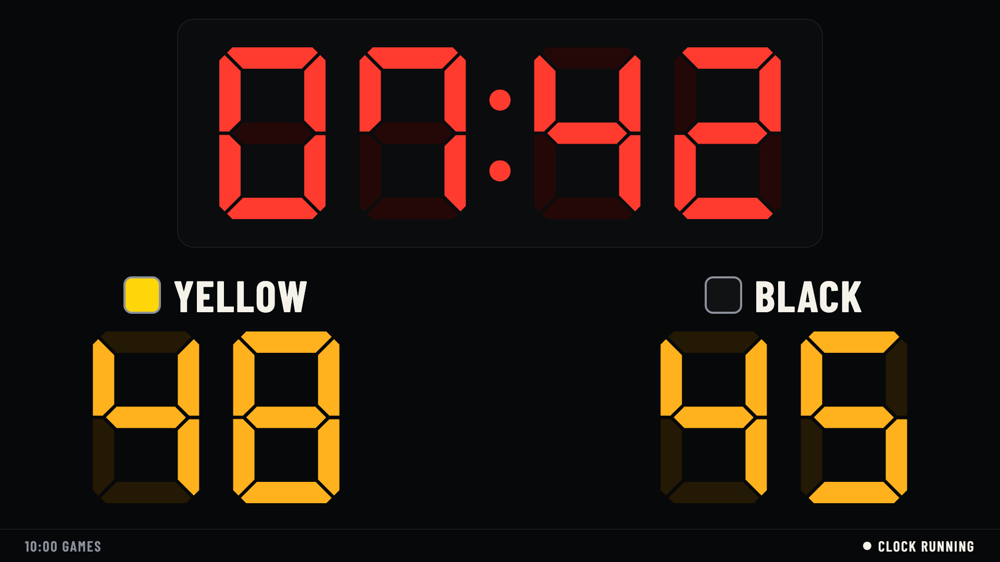
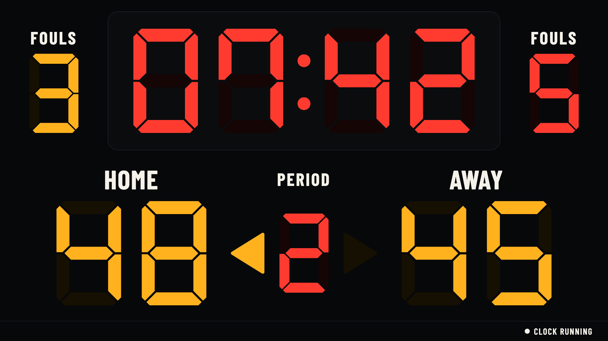
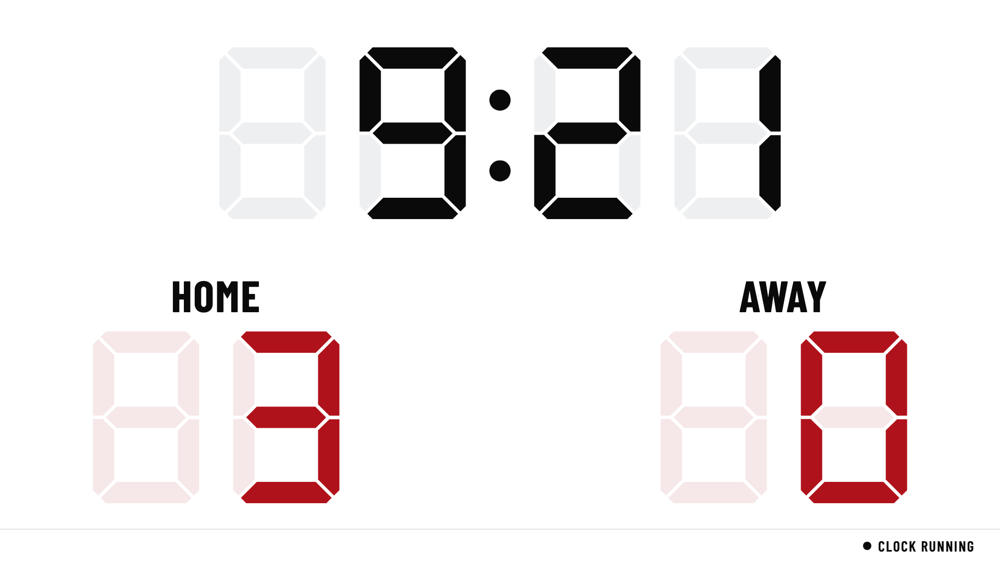
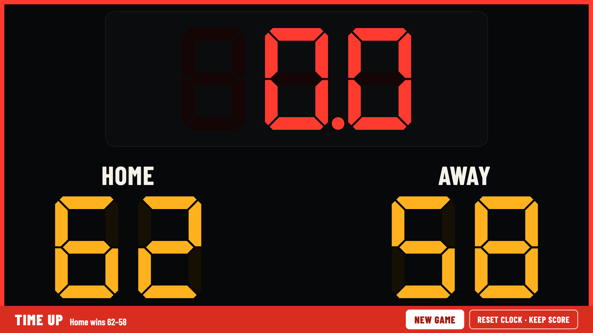
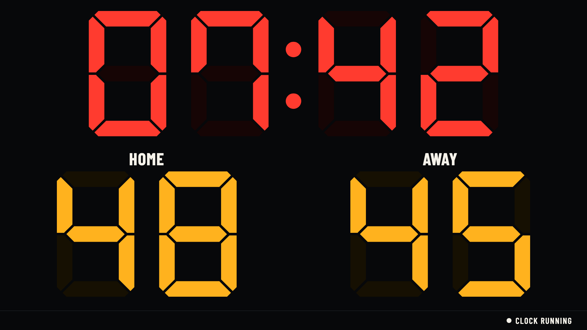
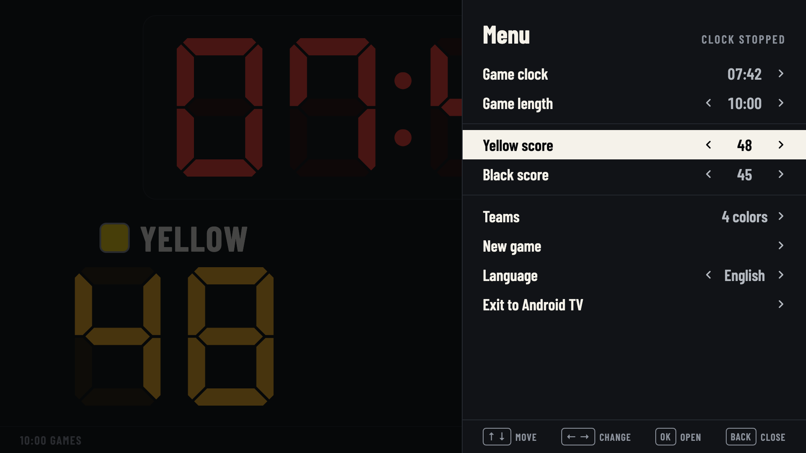
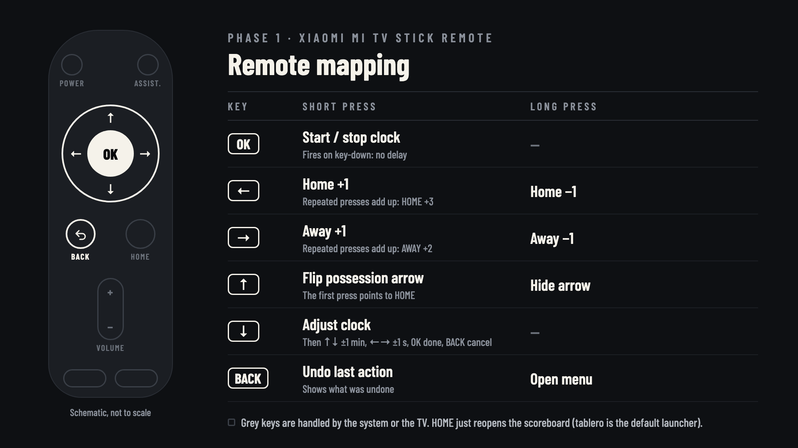

# tablero

[](https://github.com/vgt3j4d4/tablero/releases/latest)

DIY scoreboard for pickup basketball: an Android TV app on a cheap TV + streaming stick, controlled by the
stick's remote — no internet required. Later: a full 24/14 shot clock, other sports, and control from an Android
phone over local Wi-Fi.



<table>
  <tr>
    <td width="50%"><br><sub><b>FIBA rules:</b> team fouls, period and possession arrow</sub></td>
    <td width="50%"><br><sub><b>Outdoor mode:</b> readable in daylight</sub></td>
  </tr>
  <tr>
    <td><br><sub><b>Time up:</b> the buzzer sounds, then a new game (0–0) in one press</sub></td>
    <td><br><sub><b>Large layout:</b> bigger digits</sub></td>
  </tr>
  <tr>
    <td><br><sub><b>Menu:</b> hold Back</sub></td>
    <td><br><sub><b>How to use:</b> shown on the first launch, and any time from the menu</sub></td>
  </tr>
</table>

Every screen, in English and Spanish: [`docs/design/`](docs/design/README.md).

## Why

Portable LED scoreboards cost ~US$120 (~US$250 with a shot clock) and more once shipped to Peru, and they are
awkward to correct mid-game. A cheap TV plus an Android TV stick gives bigger digits, a clock you can fix in a
couple of key presses, undo, and one key press to start a new game — for under US$150 total. The same
setup can grow into a proper 24/14 shot clock and phone control.

## Features

What the TV app does today (Phase 1):

- **Made for pickup sessions:** back-to-back games on one running clock. The time on the clock when a game first
  starts becomes the game length, so set 7:00 once and every new game is 7 minutes.
- **Two teams, HOME and AWAY,** with LED-style scores and a possession arrow; a game clock that shows tenths under
  1:00, and a buzzer at 0.
- **Fix anything fast:** undo the last action (even a new game started by mistake), and adjust the clock by
  minutes or seconds while it runs.
- **Two rule sets** (menu → Rules): *Pickup*, the default, and *FIBA*, with team fouls, four periods with breaks
  between them, and overtime.
- **Two layouts** (*Classic*, *Large*) and **two modes** (*Indoor* LED look, *Outdoor* light board for daylight).
- **English and Spanish** built in, chosen in the menu; adding a language only takes a translation file.
- **Runs offline on cheap sticks and Google TV sets** (see [Hardware](#hardware)). The game survives the app being
  killed, and a power cut (the clock comes back stopped). On the Xiaomi stick the scoreboard is the home screen.

## The remote

Only the D-pad, its center button and Back are used, so any Android TV remote works.

| Key  | Press                                          | Hold                                     |
| ---- | ---------------------------------------------- | ---------------------------------------- |
| OK   | Start / stop the clock                         | —                                        |
| ←    | HOME +1 (press twice for 2, three times for 3) | HOME −1                                  |
| →    | AWAY +1                                        | AWAY −1                                  |
| ↑    | Flip the possession arrow                      | Hide the arrow                           |
| ↓    | Adjust the clock (↑/↓ ±1 min, ←/→ ±1 s)        | Team foul, FIBA rules only (then ← or →) |
| Back | Undo the last action                           | Open the menu                            |

## Install

Download `tablero-tv-<version>.apk` from the [latest release](https://github.com/vgt3j4d4/tablero/releases/latest)
and install it on the stick over adb (enable it as in [`docs/stick-setup.md`](docs/stick-setup.md) step 1):

```bash
adb connect <stick-ip>:5555
adb install -r tablero-tv-<version>.apk
```

On the Xiaomi stick, `scripts/setup-stick.sh <stick-ip> --apk tablero-tv-<version>.apk` installs it and prepares the
stick in one go: it removes the apps a scoreboard doesn't need and makes tablero the home screen.

## Hardware

| Part           | Example                                                                    | Approx. cost (Lima, Oct 2026) |
| -------------- | -------------------------------------------------------------------------- | ----------------------------- |
| Display device | Xiaomi Mi TV Stick (MDZ-24-AA), Fire TV Stick 2nd gen — or a Google TV set | already owned                 |
| TV             | 32" HD, e.g. Miray MS32-E2000GBT (Google TV, 16 W speakers)                | ~S/ 399                       |
| Optional       | Wired powered speaker (+ HDMI audio extractor if the TV has no audio out)  | ~S/ 100–170                   |
| Controller     | The stick's remote                                                         | included                      |

Details: [`docs/hardware.md`](docs/hardware.md).

## How it works

The stick owns the game; the remote (and later the phone) only sends it commands, so a controller dropping out never
stops the clock.

```
 ┌────────────────────────────────┐        HDMI        ┌──────────────────────────────┐
 │  Android TV stick / Google TV  │ ─────────────────▶ │  TV (24–32", built-in audio) │
 │  tablero tv-app                │                    │  scoreboard + buzzer         │
 │  • GameEngine (owns the clock) │                    └──────────────────────────────┘
 │  • WebSocket server (Phase 2)  │
 └────────────────▲───────────────┘
        Bluetooth │ remote (Phase 1)        local Wi-Fi (phone hotspot) │ WebSocket (Phase 2)
                  │                                                     │
          ┌───────┴──────┐                                    ┌─────────┴──────────┐
          │ Stick remote │                                    │ tablero remote-app │
          │ (scorer)     │                                    │ (referee / table)  │
          └──────────────┘                                    └────────────────────┘
```

More in [`docs/architecture.md`](docs/architecture.md).

## Status

Phase 1 is released; what's left of it is testing on real courts, tracked with everything else in
[`docs/roadmap.md`](docs/roadmap.md).

| Phase | Scope                                                                           | Status           |
| ----- | ------------------------------------------------------------------------------- | ---------------- |
| 1     | TV app + stick remote, Pickup and FIBA rules                                    | released         |
| 2     | Phone controller over Wi-Fi                                                     | —                |
| 3     | Locked-phone control (volume keys, clicker, notification)                       | —                |
| 4     | Shot clock, timeouts, more presets, controller roles, more languages and sports | —                |

## Getting started (developers)

Requires JDK 17+ and the Android SDK (Android Studio recent enough for AGP 9.4).

```bash
./gradlew :shared:test                 # engine unit tests
./gradlew :tv-app:assembleDebug
adb connect <stick-ip>:5555
./gradlew :tv-app:installDebug
```

Preparing the stick (developer mode, debloat, tablero as the home app): [`docs/stick-setup.md`](docs/stick-setup.md);
[`scripts/setup-stick.sh`](scripts/setup-stick.sh) does it in one go.

## Docs

- [Design (TV screens)](docs/design/README.md)
- [Architecture](docs/architecture.md)
- [Hardware](docs/hardware.md)
- [Stick setup](docs/stick-setup.md)
- [Releasing](docs/releasing.md)
- [Roadmap](docs/roadmap.md)

## License

[MIT](LICENSE). Bundled fonts keep their own license, the SIL Open Font License 1.1, and ship unmodified with
their license files:

| Font | Version | Source | License file |
| --- | --- | --- | --- |
| DSEG7 Classic Bold | 0.46 | [keshikan/DSEG](https://github.com/keshikan/DSEG) | [`OFL-DSEG.txt`](tv-app/src/main/assets/licenses/OFL-DSEG.txt) |
| Barlow Condensed 500–800 | 1.422 | [jpt/barlow](https://github.com/jpt/barlow) | [`OFL-BarlowCondensed.txt`](tv-app/src/main/assets/licenses/OFL-BarlowCondensed.txt) |

The time-up buzzer (`tv-app/src/main/res/raw/buzzer.wav`) is synthesized by
[`scripts/make-buzzer.py`](scripts/make-buzzer.py) and is covered by the MIT license like the code. The launcher
banner and icon are vector drawables that [`scripts/make-icons.py`](scripts/make-icons.py) draws from the bundled
fonts' glyph outlines; the font files themselves are not modified.

The app's font files are in `tv-app/src/main/assets/fonts/`. The design mockups use the same fonts as web fonts in
`docs/design/fonts/`.
